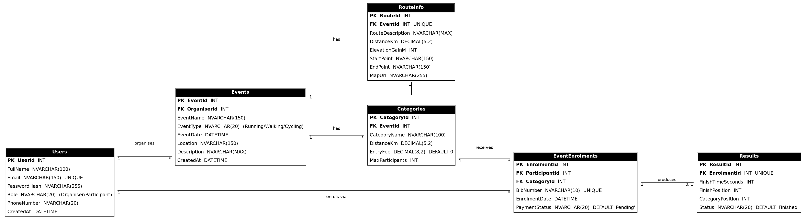
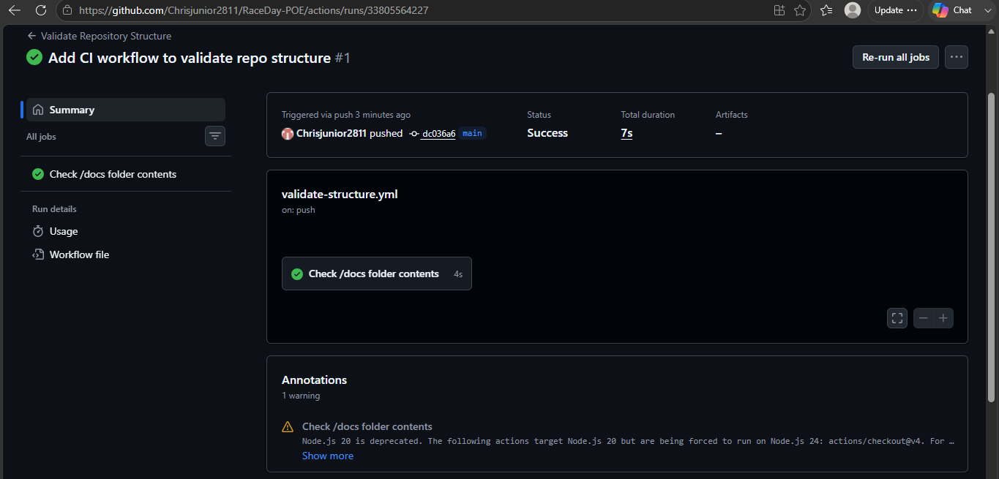

# RaceDay

**RaceDay** is a full-stack event management system for the South African road running, walking and cycling community.
It replaces paper-based registration, spreadsheets and disconnected communication channels with one platform:

- **Event Organisers** create and manage events, entry categories, enrolments and race results.
- **Participants** browse upcoming events, enrol, follow their enrolment status and track their personal race history.

This repository is my **PROG6212 Portfolio of Evidence**, built progressively in three parts.

| Part | What I built | Where |
|---|---|---|
| **Part 1** - System Planning and Database | ERD, API endpoint plan, SQL Server script | [`docs/`](docs) |
| **Part 2** - RESTful API | ASP.NET Core Web API, EF Core, JWT roles, Swagger, unit tests, CI | [`Part2/`](Part2) |
| **Part 3** - MVC web application | ASP.NET Core MVC front end, session login, Azure Blob Storage, Docker | [`Part3/`](Part3) |

## Contents
1. [Roles](#roles)
2. [Quick start with Docker](#quick-start-with-docker)
3. [Repository layout](#repository-layout)
4. [Architecture](#architecture)
5. [Part 1 - Planning and database](#part-1---system-planning-and-database)
6. [Part 2 - RESTful API](#part-2---restful-api)
7. [Part 3 - MVC web application](#part-3---mvc-web-application)
8. [Swagger](#swagger)
9. [Unit tests](#unit-tests)
10. [CI/CD](#cicd)
11. [Changes from the original plan](#changes-from-the-original-plan)
12. [Known limitations](#known-limitations)
13. [Troubleshooting](#troubleshooting)
14. [Demo videos](#demo-videos)

---

## Roles

RaceDay is a role-based system with two types of user.

### Event Organiser
- Registers (with an organiser registration code) and logs in.
- Creates, updates and deletes their own events, including name, description, date, location, distance, event type and a banner image.
- Adds and manages entry categories (distance or age) for each event.
- Views everyone enrolled for their events, with category and status, and confirms enrolments.
- Captures race results (finish time and positions) after an event.

### Participant
- Registers and logs in.
- Browses upcoming events and filters them.
- Enrols in a category and receives a bib number.
- Views and cancels their own enrolments, with colour-coded status.
- Views their personal race history, for example "47th out of 312 finishers".
- Updates their profile and uploads a profile picture.

Role rules are enforced **on the server** (in the API with `[Authorize(Roles = ...)]` plus ownership checks, and in the MVC app with a session filter), so hiding a menu item is never the only protection. A request with no login gets **401**; the wrong role gets **403**.

---

## Quick start with Docker

**Requirements:** [Docker Desktop](https://www.docker.com/products/docker-desktop/), running.

```
docker compose up --build
```

The first start takes a few minutes while the images build and SQL Server starts. Then open:

| What | Address |
|---|---|
| RaceDay web app (MVC) | http://localhost:5090 |
| API and **Swagger UI** | http://localhost:5080/swagger |

Stop everything with `docker compose down` (add `-v` to also delete the database and uploaded images).

The compose file starts four containers: **SQL Server**, **Azurite** (a local Azure Blob Storage emulator), the **API** and the **web app**.
The API creates the `RaceDayApi` database and applies its migrations automatically on start-up.

**First use**
1. Open http://localhost:5090 and click **Register**.
2. Register a **Participant**, then register an **Organiser** (choose "Organiser" and enter the registration code `RACEDAY-ORGANISER-2026`).
3. Log in as the Organiser: create an event with a banner and add a category.
4. Log in as the Participant (use a private window): enrol.
5. Back as the Organiser: confirm the enrolment and capture a result. The Participant's **My results** page then shows it.

The containerised app behaves exactly like the app run locally from Visual Studio: it is the same code, and only the connection strings and URLs change through environment variables in `docker-compose.yml`.

**Using a real Azure Storage account:** copy `.env.example` to `.env`, set `AZURE_STORAGE_CONNECTION_STRING` to your storage account's connection string, and run `docker compose up --build` again.

---

## Repository layout

```
Race-Day-POE/
  docs/                     Part 1: ERD, endpoint plan, SQL script, screenshots
  Part2/
    RaceDay.Api/            the REST API (also handles Azure Blob Storage)
    RaceDay.Tests/          unit tests for the API
  Part3/
    RaceDay.Web/            the MVC web app (calls the API only)
  docker-compose.yml        starts the whole system with one command
  RaceDay.sln               API + tests + MVC app in one solution
  .env.example              optional settings for Docker
  .github/workflows/        CI: structure check, build, tests, Docker builds
```

---

## Architecture

```
Browser --> MVC web app (Part 3) --> REST API (Part 2) --> SQL Server
                                          |
                                          +--> Azure Blob Storage (images)
```

- The **MVC app has no database access and no copied business logic.** Every read and write is an HTTP call to the API through one class, `Part3/RaceDay.Web/Infrastructure/ApiClient.cs`.
- The **API** owns the data, validation, authentication, authorisation and file handling.
- **Images** go MVC -> API -> Azure Blob Storage, and come back the same way. The MVC app and the browser never talk to Azure directly.

**Technology:** C#, ASP.NET Core 8 (Web API and MVC), Entity Framework Core 8 (code-first), SQL Server, JWT bearer tokens, BCrypt password hashing, Swagger (Swashbuckle), Azure Blob Storage (Azurite locally), Bootstrap 5, xUnit, Docker and Docker Compose, GitHub Actions.

---

## Part 1 - System Planning and Database

All Part 1 work is in the [`docs`](docs) folder.

| File | Description |
|---|---|
| [`raceday_erd.png`](docs/raceday_erd.png) | Entity Relationship Diagram |
| [`api_endpoint_plan.md`](docs/api_endpoint_plan.md) | Endpoint plan: method, route, description, role required, request body and responses for every endpoint |
| [`raceday_schema.sql`](docs/raceday_schema.sql) | SQL Server script: creates the database, tables and constraints, and seeds sample data |



### Data model (six entities)

| Entity | Purpose | Key relationships |
|---|---|---|
| `Users` | Organisers and Participants, told apart by `Role` | One Organiser has many Events; one Participant has many Enrolments |
| `Events` | An event with name, type, date, location, description | Belongs to one Organiser; has many Categories; has one RouteInfo |
| `RouteInfo` | Route and distance details | One-to-one with an Event |
| `Categories` | Entry categories (for example 5km, 10km, Under 20) | Belongs to one Event; has many Enrolments |
| `EventEnrolments` | Links a Participant to a Category and issues a bib number | One-to-zero-or-one with a Result |
| `Results` | Finish time and positions | Belongs to one Enrolment |

Primary keys, foreign keys, `UNIQUE`, `NOT NULL`, `CHECK` and `DEFAULT` constraints are defined in the SQL script, and the EF Core model in Part 2 matches it.

### Running the SQL script
Open SSMS, connect to your SQL Server instance, open `docs/raceday_schema.sql` and press **Execute**. The script can be re-run safely because it drops the tables first. It seeds 2 organisers, 2 participants, 3 events, categories, enrolments and a sample result.

### Part 1 CI/CD
`.github/workflows/validate-structure.yml` checks that `/docs` contains the ERD, the endpoint plan and the SQL script, and that a README exists.



---

## Part 2 - RESTful API

The API in [`Part2/RaceDay.Api`](Part2/RaceDay.Api) implements the Part 1 endpoint plan using ASP.NET Core Web API, Entity Framework Core (code-first) and SQL Server.

### Setup and run (Visual Studio)
**Requirements:** Visual Studio with the ASP.NET workload, .NET 8 SDK (or newer), SQL Server (LocalDB or full) and SSMS.

1. Open `RaceDay.sln` (repo root).
2. In `Part2/RaceDay.Api/appsettings.json`, set `ConnectionStrings:DefaultConnection` to your SQL Server (default is `(localdb)\MSSQLLocalDB`). The API creates its own database, `RaceDayApi`, so it does not clash with the Part 1 `RaceDay` database.
3. Open **Tools > NuGet Package Manager > Package Manager Console**, set *Default project* to `RaceDay.Api`, and run `Update-Database`. (The migrations are in `Part2/RaceDay.Api/Migrations`; the app also applies pending migrations on start-up.)
4. Image storage: start Azurite, or put a real Azure connection string in `AzureStorage:ConnectionString`. The default `UseDevelopmentStorage=true` targets Azurite.
5. Run the API with the **http** profile. It listens on `http://localhost:5080` and opens Swagger.
6. Run the tests with **Test > Run All Tests**, or `dotnet test RaceDay.sln`.

### Authentication and roles
- `POST /api/auth/register` and `POST /api/auth/login`. Login returns a **JWT** that carries the user id and role, and acts as the session token.
- Passwords are hashed with **BCrypt**; the original password is never stored.
- Registering as an **Organiser** also needs the organiser registration code (`RACEDAY-ORGANISER-2026` by default, set in `appsettings.json`), so nobody can simply choose to be an organiser.
- Non-public endpoints need a valid token; organiser endpoints reject participants (403) and the reverse; organisers can only change their own events.

### Endpoints
All 21 endpoints from the Part 1 plan are implemented with the same routes, roles and response codes.

| Area | Endpoints |
|---|---|
| Authentication | `POST /api/auth/register`, `POST /api/auth/login` |
| User profile | `GET` and `PUT /api/users/me`, `GET /api/users/me/history` |
| Events | `GET /api/events`, `GET /api/events/{id}`, `POST /api/events`, `PUT /api/events/{id}`, `DELETE /api/events/{id}` |
| Categories | `GET` and `POST /api/events/{id}/categories`, `PUT` and `DELETE /api/categories/{id}` |
| Enrolments | `POST /api/categories/{id}/enrol`, `GET /api/enrolments/me`, `GET /api/events/{id}/enrolments`, `DELETE /api/enrolments/{id}` |
| Results | `POST /api/enrolments/{id}/result`, `GET /api/events/{id}/results`, `GET /api/results/{id}` |

Endpoints added later for the web app and image storage are listed under [Changes from the original plan](#changes-from-the-original-plan).

### Code structure
```
Part2/RaceDay.Api/
  Controllers/   one controller per area (Auth, Users, Events, Categories, Enrolments, Results)
  Models/        EF Core entities that mirror the ERD
  Data/          RaceDayDbContext: table names, keys, constraints, defaults
  Dtos/          request and response objects (entities and password hashes are never returned)
  Mapping/       entity-to-DTO mapping and query projections
  Services/      TokenService (JWT), Azure Blob Storage service, image validator
  Migrations/    EF Core migrations
  Program.cs     dependency injection, JWT auth, Swagger, middleware pipeline
```

### Part 2 CI/CD


---

## Part 3 - MVC web application

The MVC app in [`Part3/RaceDay.Web`](Part3/RaceDay.Web) is a front end for the API.

### Organiser pages
| Page | What it does |
|---|---|
| Dashboard | Totals for events, upcoming events and enrolments; the next event; every event with its category and enrolment counts and date |
| My events | Create, edit and delete events with all required fields (name, description, date, location, distance, event type) and **banner image upload** |
| Categories | Add, edit and delete distance or age categories for an event |
| Enrolments | Everyone enrolled for an event with category, bib number and status; confirm an enrolment or set it back to pending |
| Results | Capture finish time (`hh:mm:ss`), overall position, category position and status (finished, DNF, DSQ); saved results are visible to the participant immediately |

### Participant pages
| Page | What it does |
|---|---|
| Home | Upcoming events with filters: name or location, event type, minimum and maximum distance |
| Event details | Full event information, banner, route notes and categories; choose a category and enrol (recorded immediately) |
| My enrolments | Every event entered, with category, bib and status; cancel an enrolment |
| My results | Race history: event, date, category, finish time and position ("47th out of 312 finishers") |
| Profile | View and update personal information and upload a **profile picture** |

Enrolment status colours: **green = Confirmed**, **amber = Pending**, red = Cancelled. ("Confirmed" is stored as `Paid` in the database.)

### Authentication and session management
- Users register and log in through the MVC app, which calls the API.
- On login, the API token, role and name are kept in the **server-side session** (`ISession`). The token is never exposed to the browser.
- `[SessionAuthorize]` protects pages: not logged in goes to the login page; the wrong role goes to an Access Denied page. Organisers and Participants have different menus and pages.
- **Log out** ends the session and redirects to the login page. If the API stops accepting the token (it expires after 60 minutes), the session ends and the user is sent to log in again.
- Every form is protected with anti-forgery tokens.

### Azure Blob Storage
Event banners and profile pictures are stored in Azure Blob Storage **through the API**.

- API endpoints: `POST` and `GET /api/events/{id}/banner`, `POST` and `GET /api/users/me/picture`.
- Allowed: JPG, PNG or WebP up to 5 MB. The API checks the file's real signature, not only its name.
- The container is **private**. Only the blob name is saved in the database, so the app controls who can see each image.
- Uploads work against a real Azure Storage account or the Azurite emulator, chosen by the connection string.

### Docker
- `Part3/RaceDay.Web/Dockerfile` and `Part2/RaceDay.Api/Dockerfile` are **multi-stage** builds: the SDK image builds the app and a small ASP.NET runtime image runs it. Dependencies are restored in their own layer for fast rebuilds, and the app runs as a **non-root user**.
- `docker-compose.yml` wires the services together and waits for SQL Server to be healthy before starting the API.
- **Run command:** `docker compose up --build`

### UI design
The interface uses Bootstrap 5 with a custom RaceDay theme (navy, race-day orange and lime, with condensed headings) applied consistently on every page. Every page is reachable from a role-appropriate navigation menu, and the layout is responsive.

### Handling invalid input
Forms validate on the server (and in the browser) with a clear message beside each field. API errors are turned into one short sentence, a stopped API shows a "service not reachable" message, and any unexpected error shows a friendly error page, never a stack trace.

### Part 3 CI/CD
The workflow `.github/workflows/dotnet-ci.yml` builds the API, the unit tests **and the MVC project**, runs every test, and builds both Docker images.


---

## Swagger

The API publishes Swagger UI so every endpoint can be viewed and tested in the browser without extra tools.

- Docker or Visual Studio: **http://localhost:5080/swagger**
- Each endpoint shows what it does, the role required, the data it expects and every response code.
- To test protected endpoints: call `POST /api/auth/login`, copy the `token`, click **Authorize**, paste it and click **Authorize**.


---

## Unit tests

81 xUnit tests in [`Part2/RaceDay.Tests`](Part2/RaceDay.Tests) run the real API in memory (real JWT login and role checks, an in-memory database and a fake blob store). They cover:

- registration and login, including password hashing
- event and category management
- role rejection: **401** with no token and **403** for the wrong role or another organiser
- enrolments, enrolment confirmation and results
- event filters and the organiser's own events
- image upload rules (type, size and permissions)

```
dotnet test RaceDay.sln
```


---

## CI/CD

GitHub Actions (`.github/workflows`) runs on every push:

| Workflow | What it does |
|---|---|
| `validate-structure.yml` | Checks the repository structure (Part 1) |
| `dotnet-ci.yml` | Builds the API, tests and MVC project, runs all unit tests, builds both Docker images and validates `docker-compose.yml` |

---

## Changes from the original plan

The Part 1 plan has been followed. The additions and small differences below were made later, and each has a reason.

### Part 2
| Plan item | What was implemented | Reason |
|---|---|---|
| `POST /api/auth/register` body | Extra optional field `organiserCode`, required for Organisers | Stops anyone choosing to be an Organiser |
| `POST /api/events` body | `route.distanceKm` is required | The event distance is stored in `RouteInfo`, as in the ERD |
| `POST /api/categories/{id}/enrol` | No request body; one enrolment per event per participant | Nothing to send except the category id; prevents entering two categories of one event |
| `DELETE /api/events/{id}` | Extra `409` when the event has enrolments | Protects participant data |
| `DELETE /api/enrolments/{id}` | Extra `409` when a result exists | Keeps results consistent |
| `POST /api/enrolments/{id}/result` | Extra `400` for a Finished result with no time | Data quality |
| Database | UNIQUE constraints created by EF Core as unique indexes; database named `RaceDayApi` | EF Core behaviour; avoids "object already exists" with the Part 1 database |

### Part 3
| Change | Reason |
|---|---|
| `POST` and `GET /api/events/{id}/banner`, `POST` and `GET /api/users/me/picture` | Azure Blob Storage must be integrated into the API |
| `GET /api/events/mine` | The dashboard needs all of an organiser's events (including past ones) with enrolment counts |
| `GET /api/events` optional filters (`type`, `search`, `minDistanceKm`, `maxDistanceKm`) | Home page filtering |
| `PUT /api/enrolments/{id}/status` | Organisers confirm enrolments, so Confirmed and Pending statuses exist |
| `PUT /api/events/{id}` optional `eventType`, `distanceKm` and route fields | The edit page must be able to change every event field |
| New response fields `hasBanner`, `hasProfilePicture`, `hasResult`, `totalFinishers` | Show images only when they exist, hide "cancel" once a result exists, and show "47th out of 312 finishers" |
| Columns `Events.BannerBlobName` and `Users.ProfilePictureBlobName` (new migration) | Remember which blob holds each image |

These are also listed in [`docs/api_endpoint_plan.md`](docs/api_endpoint_plan.md) under "Additions made in Part 3".

---

## Known limitations

- A saved result cannot be edited, because the plan has no update-result endpoint.
- Event banners are streamed through the web app on each request and are not cached.
- The MVC app has no automated tests of its own; the API has 81.
- The default JWT signing key and organiser code are development values. Change them (in `.env` or `appsettings.json`) before any real deployment.

---

## Troubleshooting

| Problem | What to check |
|---|---|
| Browser says the site can't be reached | Use `http://`, not `https://`. Confirm both apps are running (ports 5080 and 5090) |
| Web app says "service is not reachable" | The API isn't running, or `Api:BaseUrl` in `Part3/RaceDay.Web/appsettings.json` doesn't match the API's port |
| API fails with a SQL error | The `Server=` value in `Part2/RaceDay.Api/appsettings.json` must match your SQL Server; run `Update-Database` |
| Banner upload shows a warning | Azurite or Azure storage isn't running (Docker starts Azurite automatically) |
| `docker compose up` stalls | Make sure Docker Desktop is running; check `docker compose logs api` |
| Page has no colours | Bootstrap loads from the internet: check your connection |

---
 


